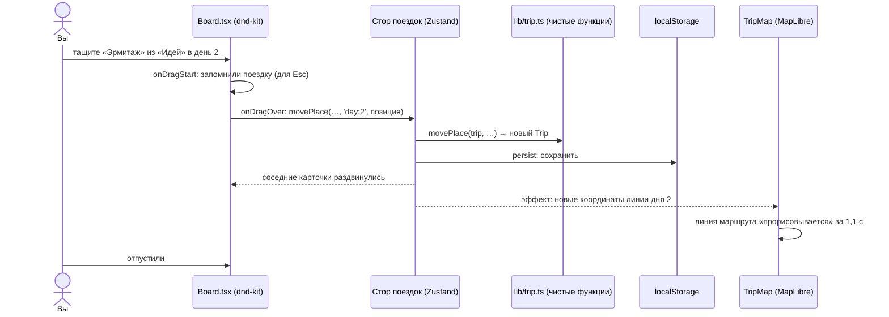

# 00. С чего начать

Этот учебник для человека, который знает React (компоненты, `useState`, `useEffect`), но ещё не
работал с **Next.js**, перетаскиванием (**dnd-kit**) и картами (**MapLibre**). «Тропа» — планировщик
путешествия: выбрал город и даты, набрал места в «Идеи», разложил их по дням перетаскиванием, видишь
маршрут каждого дня на карте и погоду.

## Как устроена каждая глава

1. **Зачем** — что видит человек и какую задачу решаем.
2. **Как это выглядит** — маленький пример.
3. **Как это сделано в «Тропе»** — настоящий код с разбором.
4. **Ошибки** — что ломается у всех в первый раз.
5. **Попробуйте сами** — задания с ответами под спойлером.

## Картинка целиком: что происходит, когда вы перетаскиваете место

Три идеи, на которых держится проект:

1. **Логика — в чистых функциях.** `lib/trip.ts` получает поездку и возвращает новую: добавить
   место, перенести, удалить день. Стор лишь вызывает их. Всё проверяется тестами без React.
2. **Next.js собирает статический сайт.** Страницы рендерятся заранее при сборке, а в браузере
   «оживают» (гидратация). Всё, что есть только в браузере (`localStorage`, карта), подключается
   аккуратно, чтобы HTML сервера и первый рендер браузера совпали.
3. **React и карта живут по-разному.** Карта — императивный объект со своим состоянием; React лишь
   синхронизирует её с пропсами в эффектах.

## Словарь в одну строку

| Слово | Простыми словами | Пример в проекте |
| --- | --- | --- |
| **Next.js App Router** | Маршруты — это папки в `app/` | `src/app/page.tsx` |
| **Серверный компонент** | Выполняется при сборке, в браузер — только HTML | `layout.tsx` |
| **Клиентский компонент** | С `'use client'`: состояние, эффекты, события | `Board.tsx` |
| **Гидратация** | React «подключается» к готовому HTML в браузере | ошибка, если HTML не совпал |
| **Статический экспорт** | `output: 'export'` — готовые файлы для хостинга без сервера | GitHub Pages |
| **`next/dynamic` + `ssr: false`** | Компонент только в браузере | карта |
| **Zustand** | Маленькое хранилище состояния | `store/trips.ts` |
| **`persist`** | Сохранять стор в `localStorage` | поездки |
| **TanStack Query** | Загрузка данных из сети с кэшем | погода, места |
| **dnd-kit** | Библиотека перетаскивания для React | дни и «Идеи» |
| **Датчик (sensor)** | Чем перетаскивают: мышь, палец, клавиатура | `useSensors` |
| **`DragOverlay`** | Копия карточки, которая едет за курсором | `Board.tsx` |
| **MapLibre GL** | Открытая библиотека векторных карт на WebGL | `TripMap.tsx` |
| **GeoJSON** | Формат географических данных: точки, линии | маршрут дня |
| **Слой (layer)** | Как рисовать данные источника на карте | линии маршрутов |
| **lz-string** | Сжатие строки так, чтобы она поместилась в адрес | ссылка «поделиться» |

## Как читать код проекта

- **Комментарий в начале каждого файла** — «зачем» и «почему так».
- **`src/lib/`** — чистая логика с тестами: поездка, даты, ссылка, гео.
- **Ищите по тексту на экране:** «Перенос отменён» → `components/planner/Board.tsx`.

## Порядок чтения

| Если вы хотите… | Читайте |
| --- | --- |
| понять, как всё разложено | [01. Архитектура](01-architecture.md) |
| Next.js для тех, кто знает React | [02](02-nextjs.md) |
| стор, загрузку данных, ссылку | [03](03-state-and-data.md) |
| перетаскивание | [04](04-drag-and-drop.md) |
| карту | [05](05-map.md) |
| публикацию | [06](06-deploy.md) |
| понять конкретный файл | [Разбор кода](code/README.md) |
