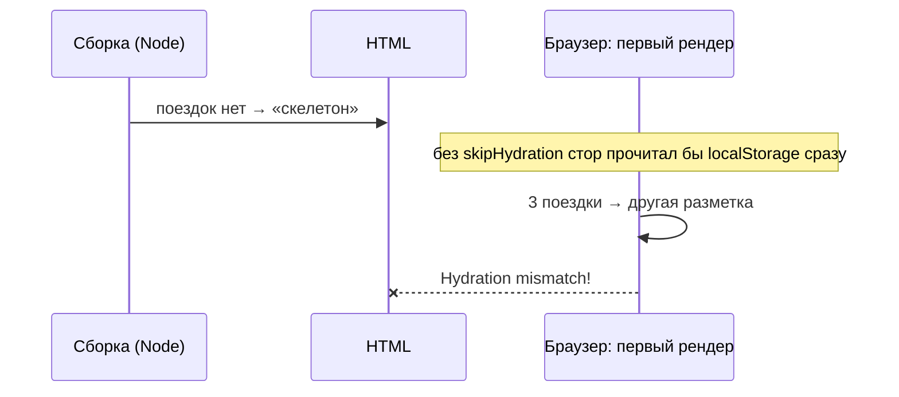

# 2. Стор и гидратация

[src/store/trips.ts](../../src/store/trips.ts), [useHydrateTrips.ts](../../src/store/useHydrateTrips.ts).
Глава — [03. Состояние и данные](../03-state-and-data.md).

## Где на экране

«Мои поездки» на главной, вся страница поездки. Закрыли браузер, открыли — поездки на месте. Пока
они читаются из `localStorage`, виден короткий скелетон.

## Стор: обёртка над чистыми функциями

```ts
export const useTrips = create<TripsState>()(persist((set) => {
  const update = (tripId: string, fn: (trip: Trip) => Trip) =>
    set((s) => {
      const trip = s.trips[tripId]
      if (!trip) return s
      const next = fn(trip)
      return next === trip ? s : { trips: { ...s.trips, [tripId]: next } }
    })

  return {
    trips: {},
    hydrated: false,
    movePlace: (id, placeId, to, index) => update(id, (t) => T.movePlace(t, placeId, to, index)),
    addPlace: (id, draft, to) => update(id, (t) => T.addPlace(t, draft, to)),
    …
  }
}, { … }))
```

- Действия стора **не содержат логики** — каждое зовёт функцию из `lib/trip.ts` через `update`.
- **`next === trip ? s`** — функция вернула ту же поездку (ничего не изменилось) — возвращаем то же
  состояние, и Zustand никого не будит.
- Поездки — словарём по id: найти поездку — одно обращение.

## Сохранение: `persist`

```ts
{
  name: 'tropa:trips',
  version: 1,
  storage: createJSONStorage(() => localStorage),
  partialize: (s) => ({ trips: s.trips }),
  skipHydration: true,
  onRehydrateStorage: () => () => useTrips.setState({ hydrated: true }),
}
```

| Опция | Зачем |
| --- | --- |
| `partialize` | сохранять только поездки; флаг `hydrated` — служебный |
| `version` | на будущее: изменится форма поездки — `migrate` приведёт старые данные |
| `createJSONStorage(() => localStorage)` | функция, а не сам `localStorage`: на сервере его нет, а функция вызовется только в браузере |
| **`skipHydration: true`** | **не** читать хранилище само при создании стора — см. ниже |
| `onRehydrateStorage` | после чтения — флаг «готово» |

## Почему `skipHydration`: ошибка гидратации

Next.js собирает страницы **заранее**, в Node, где `localStorage` нет. В HTML попадает пустой
список поездок. В браузере React «подключается» к этому HTML (гидратация) и ожидает, что **первый**
рендер даст точно такую же разметку.



Решение — читать хранилище **после** монтирования:

```ts
export function useHydrateTrips(): boolean {
  const hydrated = useTrips((s) => s.hydrated)
  useEffect(() => {
    if (!useTrips.getState().hydrated) void useTrips.persist.rehydrate()
  }, [])
  return hydrated
}
```

- Первый рендер в браузере: `hydrated = false` — скелетон, как в HTML. Совпало.
- Эффект (уже после гидратации) читает хранилище; `onRehydrateStorage` ставит `hydrated: true` —
  компонент перерисовывается с поездками.

```tsx
const hydrated = useHydrateTrips()
if (!hydrated) return <div className={styles.loading} />
```

## Выборка

```ts
export const selectTripList = (s: TripsState) => Object.values(s.trips).sort((a, b) => b.updatedAt - a.updatedAt)
```

Внимание: селектор возвращает **новый массив** при каждом вызове. Поэтому в `SavedTrips.tsx` он
обёрнут в `useShallow`: `useTrips(useShallow(selectTripList))` сравнивает массивы поэлементно. Без
этого Zustand на каждое обращение видел бы «новое» значение и перерисовывал бы компонент по кругу.

## Что будет, если…

| Сделать | Что сломается |
| --- | --- |
| без `skipHydration` | ошибка гидратации в консоли, мигание разметки |
| `storage: localStorage` (без функции) | сборка падает: `localStorage is not defined` |
| логика в действиях стора | её не проверить тестом без Zustand |
| сохранять `hydrated` | после перезапуска флаг «готово» прочитается раньше данных |

## Проверьте себя

1. Почему скелетон показывается даже у человека без единой поездки?
2. Что делает `persist.rehydrate()`?

<details>
<summary>Ответы</summary>

1. Пока хранилище не прочитано, неизвестно, есть ли поездки; а первый рендер обязан совпасть с HTML
   сборки.
2. Читает сохранённое из `localStorage` и подставляет в стор; после этого вызывается
   `onRehydrateStorage`.
</details>
